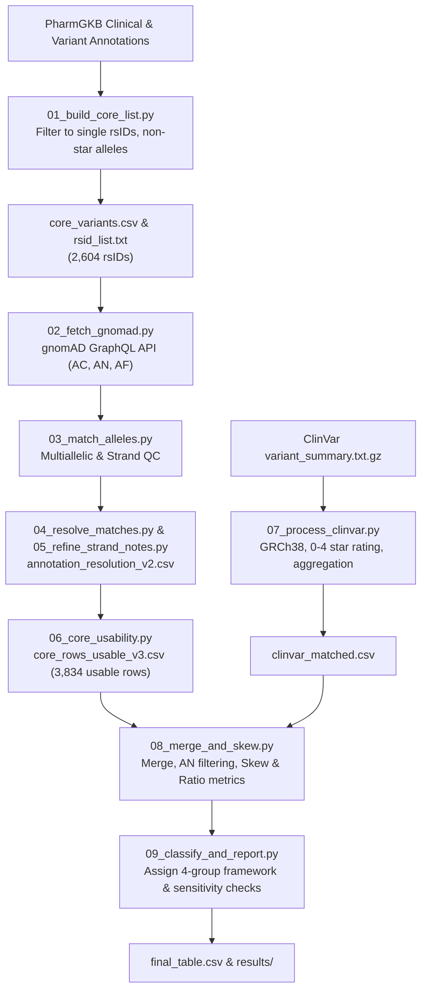

# Pharmacogenomic Variant Frequency Mapping Across Global Populations

An end-to-end audit cross-referencing population allele frequency disparities (gnomAD v4) with clinical and pharmacogenomic evidence strength (PharmGKB & ClinVar).

---

## 1. Project Overview

Genetic polymorphisms can profoundly impact drug metabolism, dosing requirements, efficacy, and toxicity risk. While population genetics studies frequently highlight allele frequency differences between ancestry groups, **a frequency disparity alone does not prove that a variant is clinically actionable or well-supported by evidence**.

This project implements a reproducible computational pipeline to audit:
1. **Population Frequency Disparity:** Allele frequency differences across five major gnomAD population groups (`AFR`, `AMR`, `EAS`, `NFE`, `SAS`).
2. **Clinical & Pharmacogenomic Evidence Strength:** PharmGKB evidence levels (1A–4) alongside ClinVar clinical assertions and review status.

The central goal is identifying the **evidence gap (Headline Group 2)**: variants with large global frequency skews ($\ge 5\times$) that are supported only by preliminary, low-tier, or missing clinical evidence.

---

## 2. Four-Group Classification Framework

| Group | Frequency Disparity | PharmGKB Evidence Level | Clinical Interpretation |
| :--- | :--- | :--- | :--- |
| **Group 1** | **High Skew** ($\ge 5\times$) | **High** (Levels 1A, 1B, 2A, 2B) | Well-supported population-specific disparity |
| **Group 2** ⭐ | **High Skew** ($\ge 5\times$) | **Low** (Levels 3, 4) | **Headline Gap:** Large frequency skew with limited/unverified evidence |
| **Group 3** | **Low Skew** ($< 5\times$) | **High** (Levels 1A, 1B, 2A, 2B) | Reliable evidence without major population skew |
| **Group 4** | **Low Skew** ($< 5\times$) | **Low** (Levels 3, 4) | Lower priority for ancestry-specific disparity audits |
| **Group X** | *Not Assessable* | Any | Excluded due to rare allele threshold ($\text{max AF} < 1\%$) or low AN ($< 1,000$) |

---

## 3. Key Findings

From an audit of **3,834 usable variant–gene–drug relationships** (2,506 unique rsIDs):

- **Group 2 (Headline Disparity Gap):** **1,178 relationships (30.7%)** spanning **775 unique rsIDs**. 50.9% of these have **no record in ClinVar**.
- **Group 1 (Well-Supported Skew):** 45 relationships (1.2%, 30 unique rsIDs), including classic markers in *DPYD*, *VKORC1*, and *CYP3A4*.
- **Group 3 (Low Skew, Reliable Evidence):** 32 relationships (0.8%, 19 unique rsIDs).
- **Group 4 (Low Skew, Low Evidence):** 2,238 relationships (58.4%, 1,444 unique rsIDs).

Skew is measured on the minor allele (the REF side is used when ALT is the major allele on average). Variants with max AF ≥ 1% that are absent (AF = 0) in another population count as high skew.
- **Group X (Not Assessable / Sub-threshold):** 341 relationships (8.9%, 264 unique rsIDs).

### Highlighted Case Studies from Group 2:
- **`rs12721646` (*CYP2B6* / Nevirapine):** AFR AF = 17.5% vs EAS AF = 0.002% (~7,830× skew). PharmGKB Level 3, absent from ClinVar.
- **`rs671` (*ALDH2* / acetaldehyde, naltrexone, heroin):** EAS AF = 24.4% vs NFE AF = 0.003% (~6,828× skew). Level 3 for these relationships despite well-known biology; the ethanol relationship is Level 2B and sits in Group 1.
- **`rs1799972` (*OPRM1* / Opioids):** AFR AF = 22.4% vs EAS AF = 0.006% (~3,347× skew). PharmGKB Level 3/4, absent from ClinVar.
- **`rs2066702` (*ADH1B* / Alcohol metabolism):** AFR AF = 19.2% vs EAS AF = 0.008% (~2,153× skew). PharmGKB Level 3, ClinVar 1-star.
- **`rs28898617` (*UGT1A* cluster / Valproic acid):** EAS AF = 4.6% vs NFE AF = 0.0005% (~8,976× skew). PharmGKB Level 3, absent from ClinVar.

---

## 4. Pipeline Workflow



---

## 5. Repository Structure

```
├── scripts/
│   ├── 01_build_core_list.py             # Step 1: Filter PharmGKB to single-rsID core list
│   ├── 02_fetch_gnomad.py                # Step 2: Query gnomAD GraphQL API across 2,604 rsIDs
│   ├── 03_match_alleles.py               # Step 2: Per-annotation allele & strand alignment
│   ├── 04_resolve_matches.py             # Step 2: Per-annotation resolution (v1)
│   ├── 05_refine_strand_notes.py         # Step 2: Strand/notes refinement (v2)
│   ├── 06_core_usability.py              # Step 2: Final core-list usability resolution
│   ├── 07_process_clinvar.py             # Step 3: Process ClinVar GRCh38 summary & derive stars
│   ├── 08_merge_and_skew.py              # Steps 4 & 5: Left-join datasets, compute AF disparity & skew
│   ├── 09_classify_and_report.py         # Step 6: 4-group classification & sensitivity analysis
│   ├── run_all.py                        # Runs steps 01-09 in order (--from NN to resume)
│   └── archive/                       # Historical & exploratory milestone scripts
├── data_clean/
│   ├── core_variants.csv              # Filtered PharmGKB baseline
│   ├── rsid_list.txt                  # 2,604 target rsIDs
│   ├── site_allele_frequencies.csv    # gnomAD allele counts and frequencies
│   ├── clinvar_matched.csv            # ClinVar aggregations per rsID
│   ├── merged_table.csv               # Merged PharmGKB + gnomAD + ClinVar table
│   ├── final_table.csv                # Classified table with 4-group labels
│   ├── sanity_checks.txt              # Pipeline sanity and distribution log
│   └── archive/                       # Intermediate diagnostic files
├── results/
│   ├── group_counts.csv               # Row and rsID distribution across the 4 groups
│   ├── top_genes_by_group.csv         # Top represented genes per quadrant
│   └── top_drugs_by_group.csv         # Top represented drugs per quadrant
├── PIPELINE_STATUS.md                 # Detailed step-by-step audit runbook
├── requirements.txt                   # Python package dependencies
└── README.md                          # Project documentation
```

---

## 6. Setup and Execution

### Prerequisites
- Python 3.10+
- Virtual environment (`venv` / `conda`)

```bash
# Clone the repository
git clone https://github.com/HemashreeJelli/BioDB.git
cd BioDB

# Install dependencies
pip install -r requirements.txt
```

### Reproducing the Pipeline
Run everything with `python scripts/run_all.py`, or step by step:

1. **PharmGKB Core Extraction:**
   ```bash
   python scripts/01_build_core_list.py
   ```
2. **gnomAD Frequency Queries & Allele Alignment:**
   ```bash
   python scripts/02_fetch_gnomad.py
   python scripts/03_match_alleles.py
   python scripts/04_resolve_matches.py
   python scripts/05_refine_strand_notes.py
   python scripts/06_core_usability.py
   ```
3. **ClinVar Evidence Extraction:**
   *(Ensure ClinVar `variant_summary.txt.gz` is available)*
   ```bash
   python scripts/07_process_clinvar.py
   ```
4. **Merge & Skew Calculation:**
   ```bash
   python scripts/08_merge_and_skew.py
   ```
5. **Classification & Summary Reporting:**
   ```bash
   python scripts/09_classify_and_report.py
   ```

---

## 7. Limitations & Context

- **Single-SNV Scope:** Star-allele genes (e.g., *CYP2D6*, *CYP2C19*) requiring haplotype phase, copy-number calling, or structural variant analysis are excluded from this single-rsID workflow.
- **ClinVar Matching by rsID:** ClinVar records are joined by rsID, not allele; at multi-allelic sites a record may describe a different ALT allele than the one measured.
- **Small-Count Ratios:** Very large disparity ratios often rest on a handful of allele copies in the lowest population; read them alongside `absolute_AF_diff`.
- **ClinVar Coverage:** ClinVar is a clinical variant archive, not a specialized pharmacogenomics database; lack of ClinVar coverage does not inherently imply lack of drug effect.
- **Ancestry Representation:** gnomAD continental populations represent broad statistical groupings rather than exhaustive global diversity.
- **Audit Tooling:** This project highlights candidates for clinical and experimental evidence audits—it does not replace individual clinical pharmacogenomic testing guidelines.
